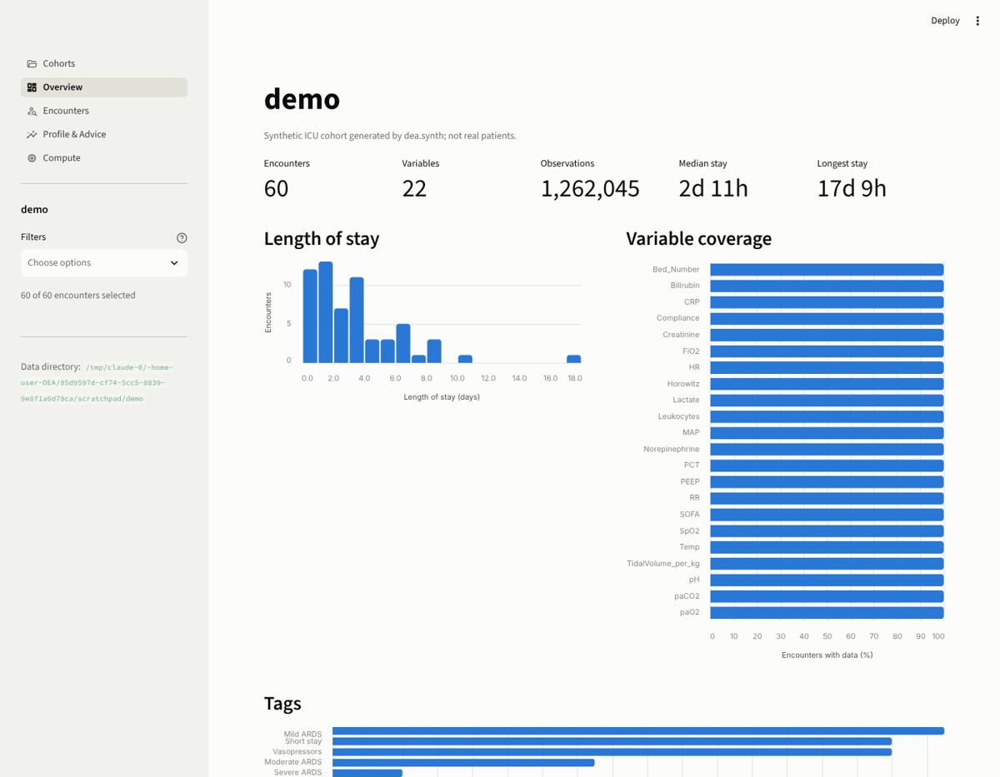
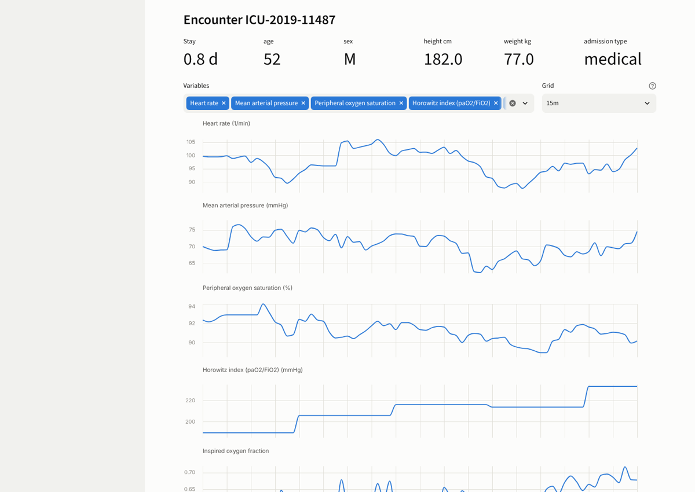

# Diagnostic Expert Advisor (DEA)

[](https://github.com/JRC-COMBINE/DEA/actions/workflows/ci.yml)


DEA turns heterogeneous clinical time-series data into one structure and gives you
profiles, views and analysis-ready frames in minutes.

- **For clinicians:** drop in a table or a folder of CSVs, get a cohort overview, per-encounter
  views and a data-quality profile without writing code.
- **For researchers:** the same cohort as a Polars or pandas frame, an encounter-level feature
  matrix, configurable filters, and one `apply()` call that runs locally today and on a SLURM
  cluster tomorrow.
- **Optional AI advisor:** recommendations on how to resample, fill and store the data, from
  any OpenAI-compatible endpoint, computed from aggregate statistics only.



> DEA v2 is a clean rewrite (Polars, Parquet, Streamlit). The v1 Flask application lives in
> the git history; its CSV layout can still be imported.

## Install

```bash
pip install "dea[all] @ git+https://github.com/JRC-COMBINE/DEA.git"
# or, from a clone:
pip install -e ".[all]"
```

Extras: `ui` (Streamlit app), `explore` (PyGWalker drag-and-drop explorer), `ai` (advisor),
`pandas` (pandas interop), `slurm` (cluster backend). The core needs only Polars, pydantic
and PyYAML.

## Five-minute tour

```bash
dea synth data/demo --n 60      # a synthetic ICU cohort; no real patients involved
dea info data/demo
dea profile data/demo
dea ui --data-dir data          # opens the app at http://localhost:8501
```

Have your own data? `dea detect my_export.csv` shows what DEA recognizes, then

```bash
dea import my_export.csv data/my_cohort            # long or wide tables, csv/tsv/parquet
dea import /path/to/v1/cohort data/migrated        # the DEA v1 static.csv + <id>/dynamic.csv tree
```



## In Python

```python
import dea

cohort = dea.load_cohort("data/demo")
cohort.summary()                       # encounters, variables, observations, length of stay
cohort.features()                      # one row per encounter: static + <variable>__min|max|mean|...
severe = cohort.filter('"Horowitz__min" < 100 AND los_hours > 24')

enc = cohort.get("ICU-2021-48213")
enc.wide(every="15m", fill="forward")  # time x variables, Polars
enc.series("MAP")                      # raw observations of one variable

frame = cohort.wide(every="1h", fill="forward", with_static=True)   # for ML, all encounters
pdf = frame.to_pandas()                                             # or stay in Polars

from dea.compute import LocalBackend
cohort.apply(my_function, backend=LocalBackend(), name="my_result")  # -> derived/my_result.parquet
```

## How it fits together

| Layer | What it does |
|---|---|
| `dea.core` | `Encounter`, `Cohort`, `CohortConfig` on Polars; long-format observations, static table, resampling |
| `dea.io` | detect & import long/wide tables and the v1 CSV tree; Parquet storage |
| `dea.profile` | deterministic profiling: sampling intervals, coverage, distributions, red flags |
| `dea.compute` | `SerialBackend`, `LocalBackend`, `SlurmBackend` behind one `map()` contract |
| `dea.advise` | optional advisor over an OpenAI-compatible API; input is the profile, never rows |
| `dea.ui` | Streamlit app: Cohorts, Overview, Encounters, Profile & Advice, Compute |
| `dea.synth` | synthetic ICU cohorts for demos and tests |

Everything domain specific (filters such as *Severe ARDS*, tags, default plots, labels, units,
processing defaults) lives in the cohort's `cohort.yaml`, not in code:

```yaml
filters:
  - label: Severe ARDS
    where: '"Horowitz__min" < 100'
processing:
  resample_every: 15m
  aggregate: mean
  fill: forward
```

More in [`docs/architecture.md`](docs/architecture.md), [`docs/data-formats.md`](docs/data-formats.md),
[`docs/ai-advisor.md`](docs/ai-advisor.md) and [`docs/hpc.md`](docs/hpc.md).

## AI advisor

```bash
export DEA_AI_BASE_URL=http://localhost:11434/v1   # e.g. Ollama; or leave unset for OpenAI
export DEA_AI_MODEL=llama3.1
dea advise data/demo --show-payload                # see exactly what would be sent
dea advise data/demo --apply                       # write the recommendation into cohort.yaml
```

The advisor receives `CohortProfile.to_prompt_dict()`: counts, sampling statistics and
per-column aggregates. No encounter ids, timestamps or individual values ever leave the
machine, and nothing changes until you apply a recommendation.

## Development

```bash
pip install -e ".[dev]"
ruff check src tests && ruff format --check src tests
pytest
```

## Status

Alpha. The data model, importers, profiler, compute backends and UI are tested on synthetic
data; the SLURM backend is implemented but not yet validated on a real cluster.

## License

GPL-3.0, see [LICENSE.md](LICENSE.md).
